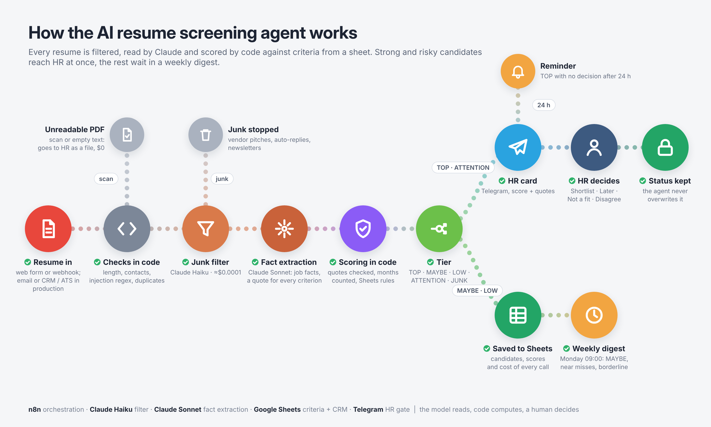
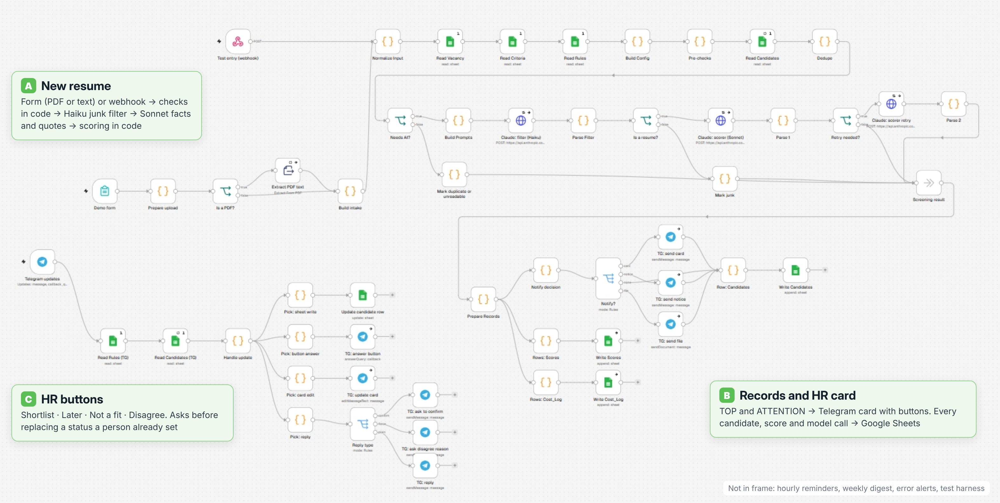

# Nordlane Software — AI Resume Screening Agent (n8n + Claude)

An HR assistant for one open role, *Customer Support Specialist (Tier 2)*, at a B2B SaaS company. It reads every resume and drops junk. It then scores each candidate against fixed criteria kept in a Google Sheet, and every point comes with a quote from the resume that code checks. Strong and suspicious candidates go to the HR manager in Telegram; everyone else goes to a weekly digest.

The agent **never rejects, never contacts a candidate and never changes a status a person set**. It sorts the pile; a human decides.

> Concept project. The company and the vacancy are fictional, every resume is synthetic test data with `example.*` addresses. The demo takes resumes through a web form (PDF upload or pasted text). For a real team the agent can be connected to a mailbox (Gmail, Outlook) or to any CRM / ATS that receives applications (via webhook or API), and take the incoming flow of CVs from there; the screening logic does not change (see [Connecting your intake](#connecting-your-intake)).



## What it does

1. **Intake**: a web form (PDF or pasted text) or a webhook; in production, a mailbox or a CRM / ATS (see below). n8n extracts the text from the PDF. If extraction fails, the PDF is a scan, or the text is under 300 characters, the resume is not lost: it is saved as `ATTENTION` and the original file is sent to HR in Telegram, at $0 model cost.
2. **Checks in code**:
   - length;
   - contact details;
   - a regular expression for prompt-injection phrases;
   - duplicate detection by email/phone and a text hash. An identical resume is a `DUPLICATE`, a changed one from the same person is a *new version*.
3. **Junk filter (Claude Haiku)**: a ≈ $0.0001 call stops vendor pitches, newsletters and auto-replies. If the filter fails, the resume goes on (fail-open).
4. **Fact extraction (Claude Sonnet)**:
   - for every job: dates, whether it was customer-facing, whether it involved technical problem solving, and the product type, with a supporting quote;
   - for each criterion: a level and a quote.

   The model has no tools and does not judge relevance or compute totals.
5. **Code does the math**:
   - checks each quote verbatim against the resume text; if a quote is not found, the model gets one retry, then the case goes to `ATTENTION`;
   - counts months of relevant experience from the dates using the rules in the sheet, with part-time and freelance work at ×0.5;
   - computes a **confidence** mark;
   - adds up the total (0–100) and sets the tier.
6. **Tiers**:

   | Tier | Rule |
   |---|---|
   | `TOP` | ≥ 70, both must-haves met, no blocking flags |
   | `MAYBE` | 50–69, or ≥ 70 with a must-have that cannot be confirmed |
   | `LOW` | < 50 or a must-have not met; *near miss* if the score is still ≥ 70 |
   | `ATTENTION` | possible injection, unreadable file, two people in one file, unclear language, unverified quotes, failed scoring |
   | `JUNK` | not a resume, or no work history at all |
   | `DUPLICATE` | the same resume sent again |

7. **HR in Telegram**:
   - `TOP` and `ATTENTION` arrive as a card with the score, must-haves, flags and the key quotes.
   - Buttons: ✅ Shortlist · ⏸ Later · ❌ Not a fit · 👎 Disagree.
   - *Disagree* asks for a one-line reason and writes it to the sheet: a running log of where HR and the agent part ways.
8. **Status safety**:
   - one `hr_status` column;
   - the agent never overwrites a status a person set;
   - an updated resume inherits the previous status, and HR gets a short notice instead of a new card;
   - a button pressed on an old card asks before replacing a newer status.
9. **Hourly check**:
   - re-sends cards that failed to send;
   - reminds HR about `TOP` candidates with no decision after 24 h.
10. **Weekly digest** (Monday 09:00): counts by tier, `TOP`/`ATTENTION` still waiting, the `MAYBE` list, near misses and `LOW` scores just under the `MAYBE` line.
11. **Logs**:
    - every model call is written to `Cost_Log` with tokens and cost;
    - every criterion score is written to `Scores` with its quote;
    - a failed production run sends an alert to Telegram.

## Design decisions

- **The model reads, code computes, a human decides.** Claude only returns JSON with facts and quotes. Months, relevance, totals, tiers, confidence, injection checks and duplicates are all code. Writing to the sheet and every status change happen in code or after a click.
- **A quote for every point.** If the model cannot quote the resume, the point does not count. Quotes are matched verbatim (whitespace-normalized), so an invented skill cannot earn a level.
- **Facts from the model, relevance from a rule.** In early tests the model's "is this job relevant?" verdict flipped between runs on the same resume (94 vs 51 months). Now the model only reports facts per job: customer-facing yes/no/unknown, technical yes/no/unknown and product type. Code applies the rule from the sheet: customer-facing **and** technical **and** software/IT or telecom.
- **Generous counting plus a confidence mark computed by code.** Only clearly irrelevant work (barista, retail, sales calls) is excluded. Jobs with `unknown` facts still count, but if counting only *confirmed* months would change the C1 level or the 24-month must-have, the candidate gets `doubt` and the card says why ("Confirmed 0 of 28 counted months…"). The model never rates its own confidence.
- **Criteria and rules live in Google Sheets**: vacancy text, 2 must-haves, 7 weighted criteria with level descriptions, thresholds, injection patterns, prices, chat id. HR can change a weight or a threshold without touching the workflow.
- **Resume text is data.** It is wrapped in tags, the prompt says to ignore instructions inside it, and a regex in code flags typical injection phrases independently of the model. An injection can at worst produce a wrong score that a human sees on an `ATTENTION` card.
- **HTTP Request to the Anthropic API instead of the n8n AI Agent node**: one deterministic call per step, full control of the payload, exact token accounting.
- **Two-model cascade**: Haiku filters junk for ≈ $0.0001, Sonnet scores real resumes for ≈ $0.018.
- **Protected information is never scored.** Age, marital status, nationality and religion are flagged (`protected_info_present`) so HR knows they were in the file, and the prompt forbids using them.

### Criteria

| ID | Criterion | Weight | Scored by |
|---|---|---|---|
| M1 | English B2 or higher | must-have | model + quote |
| M2 | ≥ 24 months of customer-facing technical support | must-have | code, from job facts |
| C1 | Relevant support experience (12 / 24 / 48 months) | 30 | code |
| C2 | Technical troubleshooting (API, logs, SQL, DevTools…) with described use | 20 | model + quote |
| C3 | Support tools (Zendesk, Freshdesk, Intercom, Jira SM…) | 10 | model + quote |
| C4 | B2B SaaS context | 10 | model + quote |
| C5 | Knowledge base and documentation | 10 | model + quote |
| C6 | English beyond B2 (C1/C2, certificates) | 10 | model + quote |
| C7 | Quantified personal results (team-wide numbers don't count) | 10 | model + quote |

## Test results

48 synthetic resumes (`tests/eval_cases.csv`), with expected tier and flags written before the run:

| Set | Cases | What it contains |
|---|---|---|
| Tuning | 28 | strong and average candidates; barista/retail only; English A2; no dates; skills listed without use; team-level metrics; part-time, internship, overlapping jobs; Ukrainian and Polish resumes; two people in one file; 3 injection attempts; vendor pitch; auto-reply; no background; garbled OCR |
| Bias pairs | 6 | the same resume with different name/origin; with and without date of birth, marital status and children; with and without nationality and religion |
| Hold-out | 14 | written after tuning, never used for fixes: internal IT helpdesk, customer success with API work, call-centre sales, freelance, unknown product type, newsletter, recruiting agency, injection in a P.S. |

Expected tiers for borderline cases were reviewed by the project owner acting as the HR manager. The suite was run **3 times** (`tests/results_3_runs.csv`, 144 results):

| Metric | Result |
|---|---|
| Tier matches expected | **136/144 (94%)** |
| Cases correct in all 3 runs | **43/48** |
| Same tier in all 3 runs (stability) | **44/48** |
| Expected flags present | **144/144** |
| Injection attempts sent to a human (`ATTENTION`) | **12/12**, incl. 6/6 runs of two attempts the regex cannot see (one disguised as an HR memo, one in Ukrainian) |
| Junk stopped by the Haiku filter | 12/12, ≈ $0.00009 each |
| Bias pairs: tier matches expected | 17/18 runs (the miss was the date bug below) |
| Processing time per resume | **≈ 12 s** average, ≈ 15 s max; junk ≈ 5 s (n8n execution time, sequential test runs) |
| Cost per scored resume | **≈ $0.018** (Haiku + Sonnet) |
| Cost of the full 144-run suite | ≈ $2.36 |

By expected tier (strict): TOP 32/33 · MAYBE 35/39 · LOW 36/36 · ATTENTION 21/21 · JUNK 12/15. Tuning set 79/84, hold-out 40/42, bias pairs 17/18.

Prices used: Sonnet $2 / $10 and Haiku $0.10 / $0.50 per million input/output tokens, applied to the logged tokens. This is a calculation, not a billing statement.

### What the tests found, and what was fixed

The 8 mismatches:

- **T23 — a note with no work history at all, 3/3 runs.** Expected `JUNK`; the agent gave `LOW` with 0 points. The owner's call as HR: someone who cannot attach a CV is not a candidate. **Fix:** a rule in code. No jobs, every criterion at level 0 and no must-have met make the resume `JUNK` (`no_background`). Checked again on this case after the fix.
- **H02, T04, T11 — borderline `MAYBE` vs `LOW`, 4 runs.** Scores of 46.6–46.8 in one run and 50–56.6 in the others for the same resume: one criterion moved one level between runs, right at the 50-point line. This is model variance at a threshold, not a wrong reading. **Fix in the process, not the model:** the weekly digest now lists "`LOW` on the edge (45–49.9)", so these candidates are not lost. The 50/70 thresholds are starting values, not calibrated on real hiring outcomes.
- **P1a — one run scored `MAYBE` 60 instead of `TOP` 90.** The date "02/2021" was not parsed, so the job had no months. The same failure set a stray `dates_missing` flag on T19 twice. A code bug, not a model error. **Fix:** the date parser now accepts `MM/YYYY`, `MM.YYYY`, `YYYY-MM`, `Mon YYYY`, year-only ranges and "present / current / to date".

Not counted as mismatches but found:

- **`protected_info_present` appeared in 5/144 runs** on resumes with nothing protected in them. The flag is informational and does not change the tier. Not fixed; noted here.
- **The Haiku filter failed silently after the test round.** The filter model started spending its output on reasoning and hit its token limit. Fail-open worked: junk went on to full scoring, at ≈ $0.02 instead of ≈ $0.0001. **Fix:** reasoning disabled for the filter call and the limit raised. Checked again on the vendor-pitch case.

The fixes were checked on the failing cases one by one; the full 3-run suite was not repeated after them.

### End-to-end checks by hand

- PDF with a text layer: `TOP` 96.7, 90 months, card in ~10 s.
- Scanned PDF with no text: `ATTENTION`, $0 model cost, original PDF delivered to the HR chat with the buttons.
- Shortlist button → status written; the status changed in the sheet by hand is kept.
- Updated resume from the same person: new version, status inherited, short notice instead of a new card.
- Disagree → reason saved to the sheet.
- Hourly run with nothing due: no messages.

## Screenshots

**n8n**: the main flows on one canvas. A: new resume, B: records and HR card, C: HR buttons. Not in the frame: the hourly check, the weekly digest, error alerts and the test harness.



Telegram cards (TOP, ATTENTION, status kept, weekly digest), the *Candidates* sheet and the test scorecard will be added here after the demo run.

## Limits

- **Synthetic data only.** 48 resumes written for this test, expectations by the test author and the owner. No real hiring pipeline, no "before/after" numbers.
- **PDF and plain text only.** No DOCX, no OCR: a scan goes to HR as a file instead of being scored.
- **The demo has no live mailbox or CRM connected**; it takes resumes through a form. Connecting one is an intake change only (see below).
- **Error alerts go to the HR chat.** In production they belong in a separate channel for whoever maintains the workflow.
- **Manual status edits in the sheet have no timestamp.** `hr_decided_at` is set only by buttons. An Apps Script `onEdit` trigger would close this gap.
- **Contact details are extracted, not validated.**
- **The bias check is small**: 3 pairs, 3 runs each. It shows the agent is not obviously swayed by a name or personal details on these resumes; it does not prove the absence of bias.
- **Thresholds (50 / 70) are starting values**, to be calibrated on real decisions. The *Disagree* log is there for that.

## Connecting your intake

Everything after intake works on plain resume text plus an optional file, so the source can be swapped without touching scoring, routing or the HR buttons:

- **Mailbox (Gmail, Outlook / Microsoft 365, IMAP):** an email trigger takes each new application and passes the PDF attachment, or the email body if there is none, into the same intake branch as the form. Auto-replies and vendor emails are already stopped by the junk filter.
- **CRM / ATS (HubSpot, Pipedrive, Zoho, Workable, Greenhouse, Lever, Teamtailor…):** a webhook from the system on "new application", or a scheduled pull through its API, sends the candidate's CV into the same branch. The tier, score and quotes can be written back to the candidate record instead of (or as well as) Google Sheets.
- **Job boards and forms:** anything that can call a webhook with the resume text or file.

Duplicate detection works across all sources, because it uses email, phone and the text hash, not the channel.

## Repository

```
workflow/hr_screening_agent.json   n8n workflow export (85 nodes, credentials and IDs removed)
prompts/prompts.md                  filter and scoring prompts
config/vacancy.csv                  the vacancy text
config/criteria.csv                 must-haves and weighted criteria with level descriptions
config/rules.csv                    thresholds, injection patterns, prices, settings
tests/eval_cases.csv                48 test resumes with expected tier and flags
tests/results_3_runs.csv            144 results: expected vs actual tier, flags, score, cost
docs/agent-flow.png                 how the agent works
docs/cover.jpg                      portfolio cover
docs/screenshots/                   Telegram, Google Sheets, n8n canvas
```

## Run it yourself

1. Import `workflow/hr_screening_agent.json` into n8n (Cloud or self-hosted).
2. Create a Google Sheet with the tabs *Vacancy, Criteria, Rules, Candidates, Scores, Cost_Log, Eval*. Fill the first three from `config/`, then replace `YOUR_GOOGLE_SHEET_ID` in the workflow.
3. Add credentials: Anthropic API, Google Sheets OAuth2, Telegram bot. Put your Telegram user id into `telegram_chat_id` in the *Rules* tab.
4. Activate the workflow, open the *Demo form* URL and send a resume. For the test suite, paste `tests/eval_cases.csv` into the *Eval* tab and click *Run eval (manual)*: clicks 1–3 send the three runs, click 4 writes the results.

## Stack

n8n · Claude Sonnet + Claude Haiku (Anthropic API) · Telegram Bot API · Google Sheets
